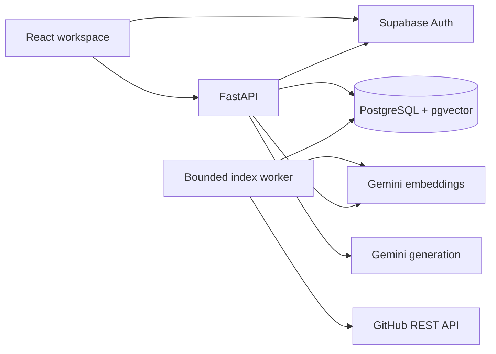

# Architecture

The React client authenticates through Supabase Email Auth. It sends its access token to FastAPI, which asks the configured Supabase Auth service for the verified user. Every repository route checks that identity against the repository owner before serving data or charging usage. All application SQL uses a private schema.

## Snapshot lifecycle

A unique owner and URL identify a repository. One active job may exist per repository. Enqueueing the job and charging the import quota occur in a single transaction. A bounded worker acquires PostgreSQL advisory locks for a processing slot and a job, then updates progress through separate short transactions. A restart releases locks and allows an interrupted job to run again. Earlier completed snapshots remain accessible while a refresh runs. Provider requests issued before an interruption can be billed again.

The importer resolves the branch and selects eligible blobs from the GitHub API tree. It downloads a bounded public ZIP from GitHub codeload at the exact commit and reads only selected members in memory. Each extracted member must match the size and Git blob ID reported by the tree. Missing or mismatched members fall back to the GitHub blob API. UTF-8 text is redacted before indexing. Parsing yields source spans, import specifiers and framework indicators. The chunker combines syntax boundaries with bounded overlapping windows. The immutable commit, path, offset and source digest contribute to each chunk ID.

Workers batch Gemini embedding requests and reuse matching content hashes within the same repository and model. A single transaction replaces the previous files and dependent rows, records the new commit and marks the job ready. A failure rolls back the replacement. Matching commits, indexing policies and embedding models skip re-embedding. A refresh after a change to file limits or chunk settings rebuilds the snapshot and reuses compatible content vectors.

## Retrieval and answers

Queries are embedded in the selected model's vector space. SQL restricts both vector and lexical candidates by repository, commit and optional file. Cosine distance uses an exact scan of the bounded repository index. Keyword, path and symbol matches complement semantic results. Reciprocal rank fusion combines their ranks. The context budget counts source characters and limits the number of excerpts. Follow-up questions use bounded recent history.

Gemini receives numbered excerpts, a separate system instruction, and a structured response schema. The API validates source identifiers and builds links from the stored path, commit and line range. Each saved entry includes its cited excerpts. Source validation establishes provenance. The model's interpretation still needs review. Documentation uses this same path with a documentation-specific request.

## Data layout

`workspaces` uses the Supabase Auth user ID as its primary key. Each `repository` owns multiple job attempts and one active snapshot. Composite foreign keys bind symbols, graph edges and vector-bearing chunks to their files. `entries` combines chat turns and saved documents with their citations in JSONB. Each repository has a single conversation. UTC usage counters are updated atomically.

## Operational bounds

Start Render with one process and one indexing slot. Workers keep one database lease connection per active slot and use a second connection for progress and saving. Scale only after checking database connection limits and provider quotas. The single process and in-memory snapshot fit small repositories. The test database adapter serializes sessions, so it verifies SQL behavior but cannot verify cross-process locking. A hosted restart-and-retry test is part of release acceptance.
