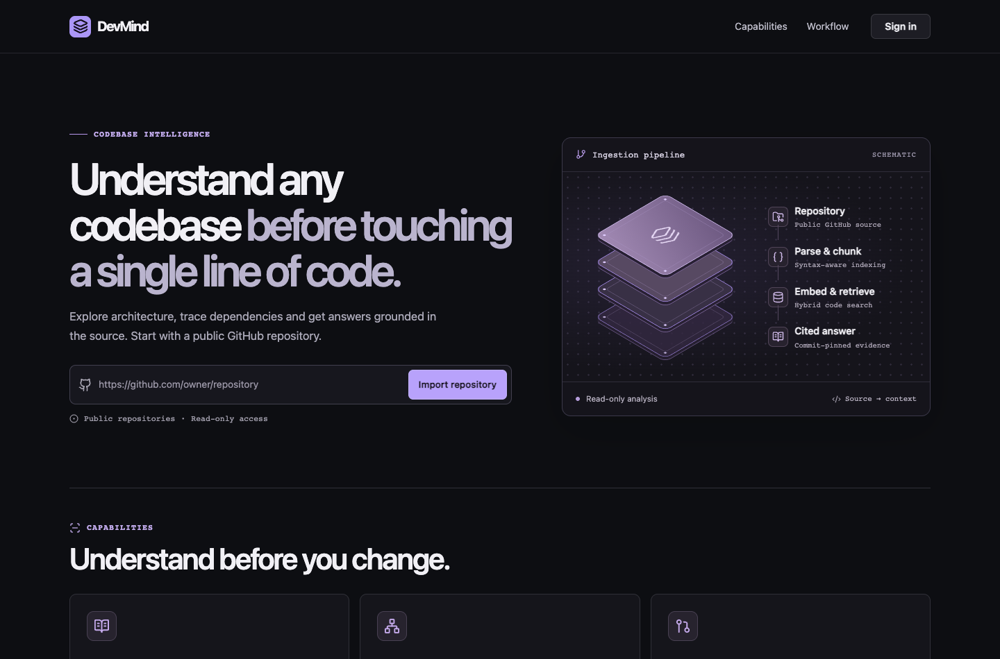

# DevMind

**Intelligence for every codebase.**

Import a public GitHub repository and ask questions about a specific commit. DevMind retrieves source excerpts, shows their line ranges, and lets you follow the imports around a proposed change.



[Mobile screenshot](docs/screenshots/landing-mobile.png)

## Run locally

Use Python 3.12, Node 24 and pnpm. The frontend declares its pnpm version in `frontend/package.json`. Run these commands from the repository root.

```sh
python3.12 -m venv .venv
.venv/bin/pip install -r backend/requirements.lock -r tests/requirements.txt
pnpm --dir frontend install --frozen-lockfile
cp -n backend/.env.example backend/.env
cp -n frontend/.env.example frontend/.env.local
```

1. Create a free Supabase project and save the database password. In **Connect**, copy the **Session pooler** PostgreSQL URI, substitute the URL-encoded database password and require TLS with `sslmode=require`. Put the result in `DATABASE_URL` in `backend/.env`. The backend needs a role that owns the DevMind tables. [Supabase connection guide](https://supabase.com/docs/guides/database/connecting-to-postgres)
2. Open the Supabase SQL Editor and run [the migration](database/001_initial.sql) once on the new database. It creates pgvector, the private application schema and tables. Keep `devmind` outside the Data API's exposed schemas.
3. Copy the project's HTTPS URL and **publishable key** from the Connect dialog or API Keys settings into `SUPABASE_URL` and `SUPABASE_PUBLISHABLE_KEY` in `backend/.env`. Put the same two values under their `VITE_` names in `frontend/.env.local`. Set `VITE_API_URL=http://127.0.0.1:8000`.
4. Enable the Email sign-in provider. Under Authentication → URL Configuration set the local site URL to `http://127.0.0.1:5173`. Register in DevMind and follow the confirmation email when enabled. Production email delivery may need a configured SMTP provider. [Supabase password authentication](https://supabase.com/docs/guides/auth/passwords)
5. Create a Gemini API key in Google AI Studio and put it in `GEMINI_API_KEY` in `backend/.env`. Check generation and embedding model access for your project. The defaults are `gemini-3.8-flash` and `gemini-embedding-001`. The migration and SDK use 768 dimensions. A different embedding space requires a repository refresh. [Model catalog](https://ai.google.dev/gemini-api/docs/models) · [Embedding API](https://ai.google.dev/gemini-api/docs/embeddings) · [API keys](https://aistudio.google.com/apikey)
6. Optionally set a GitHub token restricted to reading public repository contents. Anonymous API access may exhaust GitHub's rate limit during blob downloads. Keep the token and all Gemini and database credentials in backend settings.

On the prepared Mac checkout, run `./scripts/dev` to start both servers after stopping any existing instances. The launcher uses the local virtual environment and a project-local portable Node executable when available. Ctrl+C stops both processes.

Alternatively, start the servers in separate terminals.

```sh
.venv/bin/uvicorn backend.main:app --host 127.0.0.1 --port 8000 --reload
```

```sh
pnpm --dir frontend dev --port 5173
```

Open [DevMind](http://127.0.0.1:5173) and [API health](http://127.0.0.1:8000/health). The health endpoint reports process availability and missing configuration names. Restart the API after changing its environment file. Use one hostname consistently for sign-in, redirects and CORS.

## First repository

Paste `https://github.com/pypa/sampleproject` and sign in. Watch the download and embedding counters. When the import is ready, open an indexed file, ask “Where is the package entry point defined?” and inspect the cited lines. Use **Change impact** on a module that has incoming imports. Files with no observed import edges can legitimately have an empty impact result.

## Inside the application

| Area | Implementation |
| --- | --- |
| Ingestion | HTTPX fetches metadata, the default branch, commit tree and immutable blobs from the GitHub REST API. File filters and text redaction precede indexing. |
| Code intelligence | Python AST and JavaScript/TypeScript Tree-sitter grammars locate symbols and imports. Exact paths and source spans travel with every chunk. |
| Retrieval | PostgreSQL ranks repository-scoped chunks by pgvector cosine distance and lexical matches. Reciprocal rank fusion selects bounded evidence for Gemini. |
| Assistant | Questions and answers persist per repository. Source identifiers are checked against retrieved excerpts. Documentation uses the same evidence pipeline and supports Markdown export. |
| Workspace | React, Vite, TypeScript, Tailwind, Radix-based UI components, Monaco, React Flow, Recharts, Lucide and Framer Motion. |
| Storage | A personal workspace owns repositories, jobs, files, symbols, edges, vector-bearing chunks, usage counters and saved chat/document entries. Repository deletion cascades through its index. |

See [architecture and data boundaries](ARCHITECTURE.md), [security and retention](SECURITY.md), [deployment](docs/deployment.md), [verification results](PROGRESS.md) and [the delivery plan](PROJECT_PLAN.md).

## Checks

```sh
.venv/bin/ruff check backend tests
.venv/bin/python -m pytest -q
pnpm --dir frontend lint
pnpm --dir frontend typecheck
pnpm --dir frontend build
```

The offline suite exercises URL validation, ingestion limits, parser spans, chunk IDs, redaction, graph traversal, authentication requirements and citation validation. [Local database checks](docs/database-verification.md) exercise production SQL on pgvector. [Live acceptance tests](docs/live-tests.md) require configured services and two dedicated test accounts. See [progress](PROGRESS.md) for exactly which checks ran.

## Known limits

Only the indexed public snapshot contributes evidence. The workspace reports exclusions and GitHub tree truncation. Unsupported languages receive source viewing and text retrieval. Dynamic imports, compiler path aliases, runtime dispatch and arbitrary framework routing require human review. Impact distances measure observed import paths. Answers can misinterpret a valid excerpt. Imports use bounded memory and a full snapshot replacement when the commit changes. Old chat citations retain their commit-specific GitHub URL. Free hosting may pause idle processes and delay background jobs.
